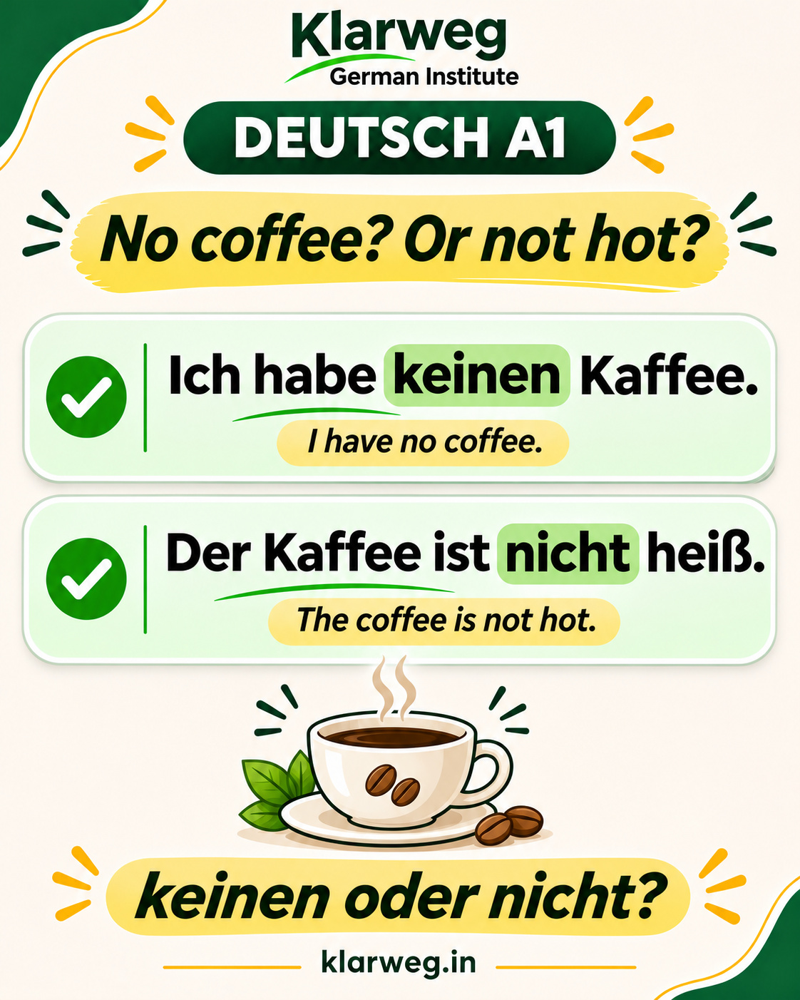
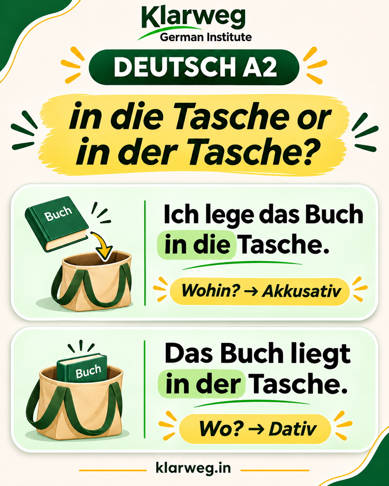
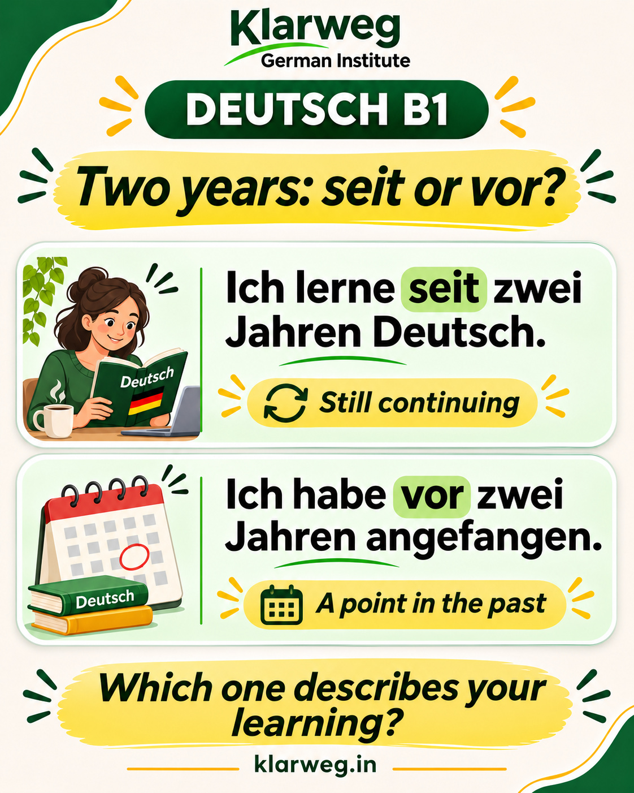
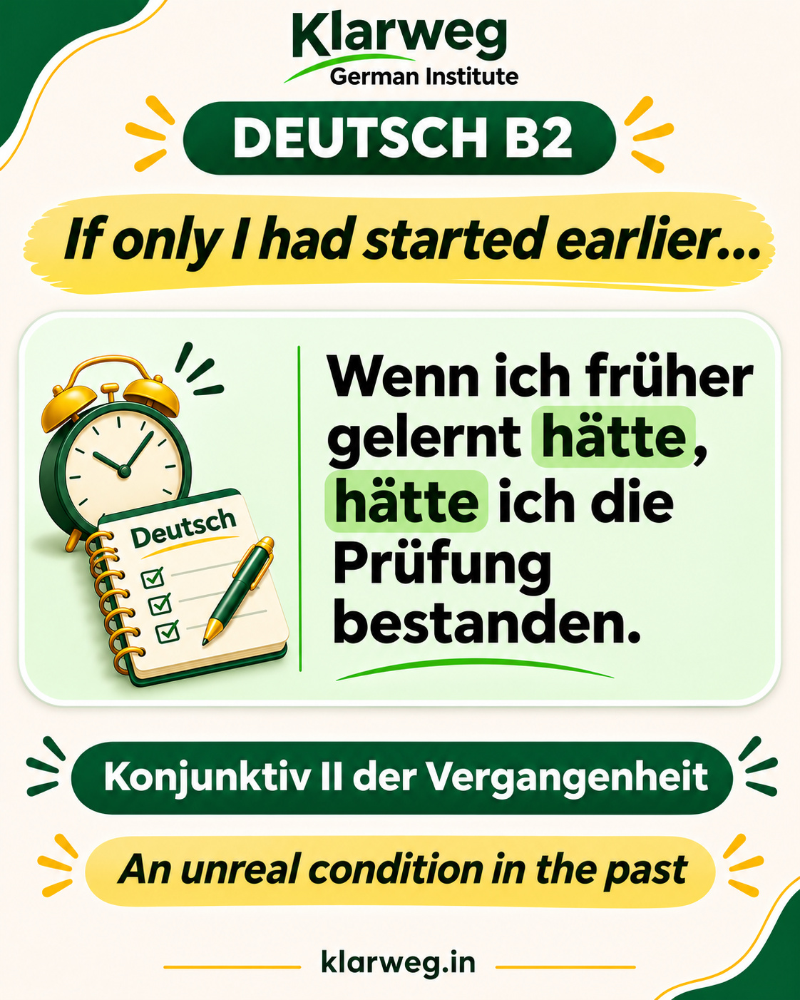
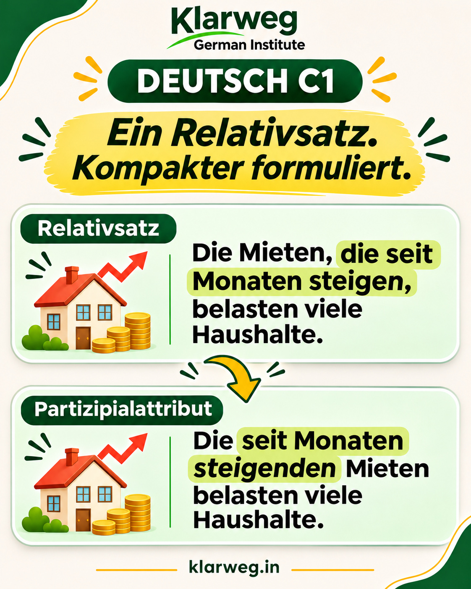
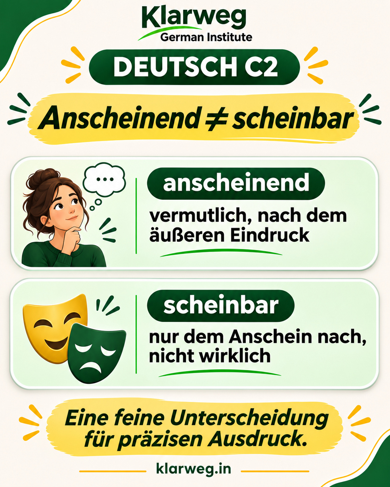

# Klarweg — six new content packages

**Status: ready for review; not scheduled or published.**

Theme: cream, forest green and gold. Six new topics, separate Facebook and Threads copy, and four ordered Instagram slides per level. Every caption includes https://klarweg.in.

| IST slot | Level | New topic | Download |
|---|---|---|---|
| 00:00 | [A1](A1/) | kein oder nicht? | [All 3 platforms](downloads/Klarweg-A1-3-platforms.zip) |
| 04:00 | [A2](A2/) | Wo oder wohin? In der / in die | [All 3 platforms](downloads/Klarweg-A2-3-platforms.zip) |
| 08:00 | [B1](B1/) | Seit oder vor? Ongoing vs past point | [All 3 platforms](downloads/Klarweg-B1-3-platforms.zip) |
| 12:00 | [B2](B2/) | Konjunktiv II Vergangenheit: unreal past | [All 3 platforms](downloads/Klarweg-B2-3-platforms.zip) |
| 16:00 | [C1](C1/) | Partizipialattribute: compact formal German | [All 3 platforms](downloads/Klarweg-C1-3-platforms.zip) |
| 20:00 | [C2](C2/) | Anscheinend oder scheinbar? A precise distinction | [All 3 platforms](downloads/Klarweg-C2-3-platforms.zip) |

## What each package contains

- Facebook: standalone lesson image and a full caption.
- Threads: the standalone visual with its own short text (under 500 characters).
- Instagram: four slides in order: lesson/hook, rule, examples, practice.
- JPEG images for API publishing and original PNGs for later design reuse.

Slot times are IST labels, not active schedules. No existing queue, posting ledger, credentials, or website deployment was changed. Instagram music is added manually after publishing.

## Previews

### 00:00 IST — A1: kein oder nicht?

### 04:00 IST — A2: Wo oder wohin? In der / in die

### 08:00 IST — B1: Seit oder vor? Ongoing vs past point

### 12:00 IST — B2: Konjunktiv II Vergangenheit: unreal past

### 16:00 IST — C1: Partizipialattribute: compact formal German

### 20:00 IST — C2: Anscheinend oder scheinbar? A precise distinction

