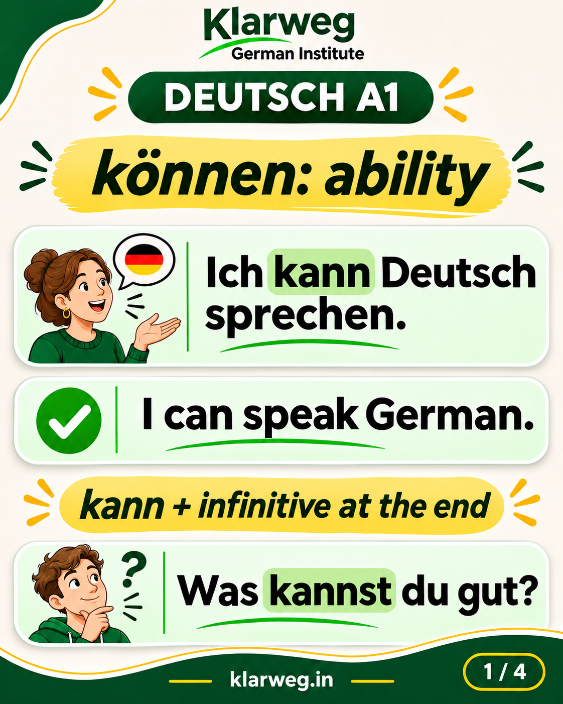
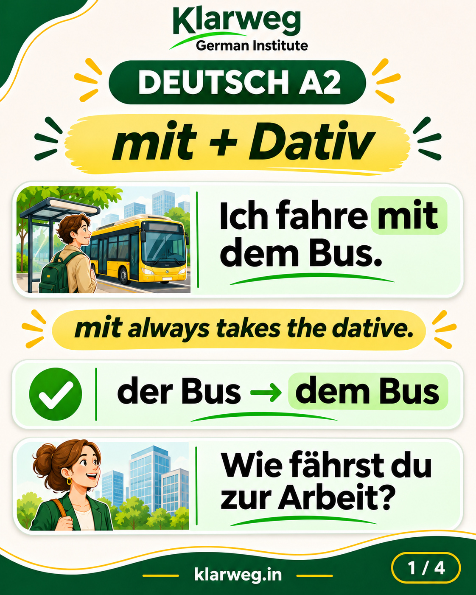
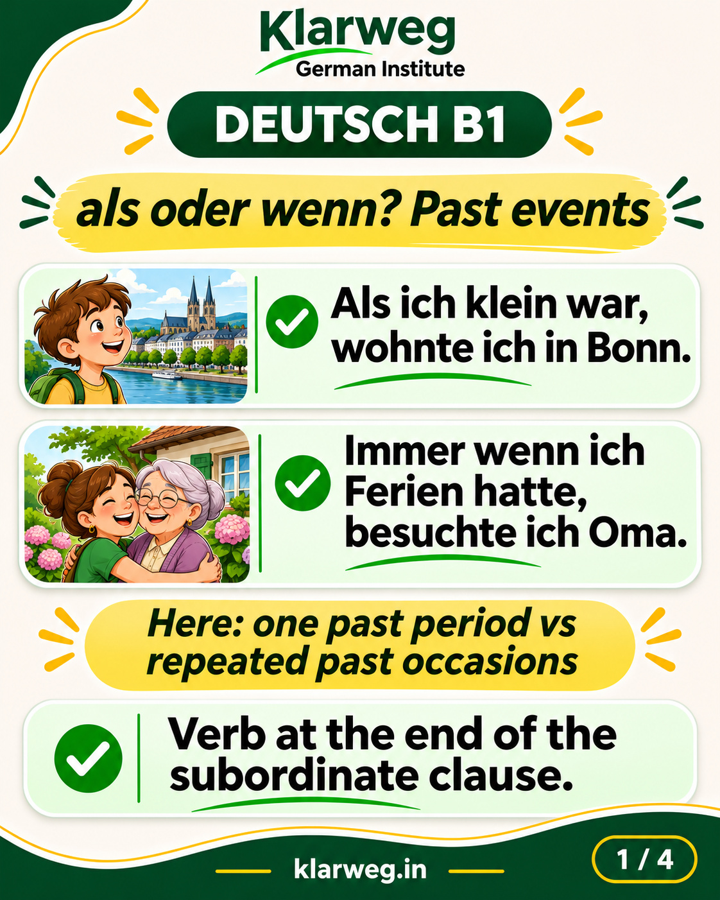
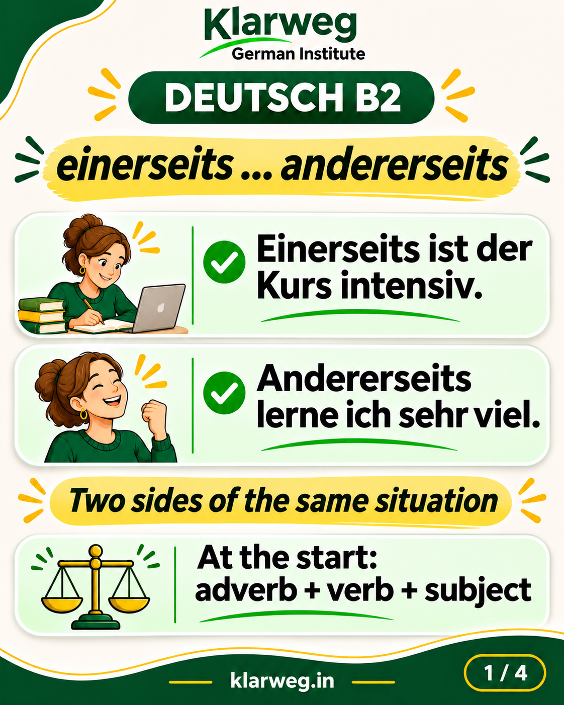
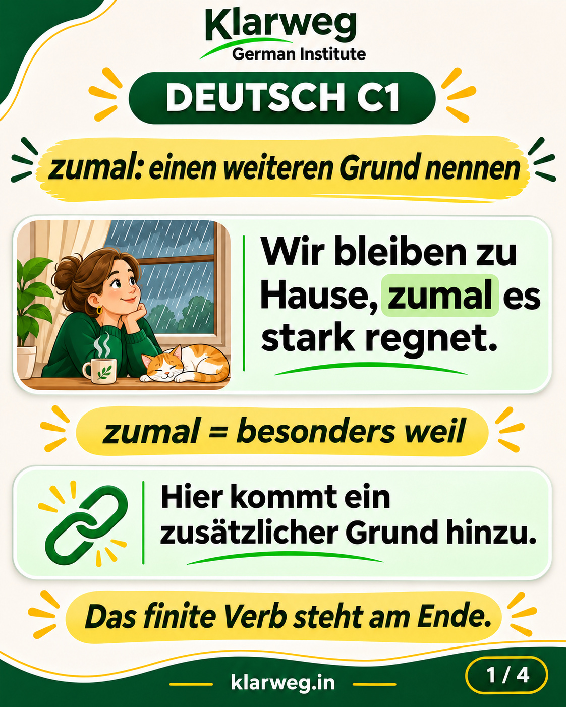
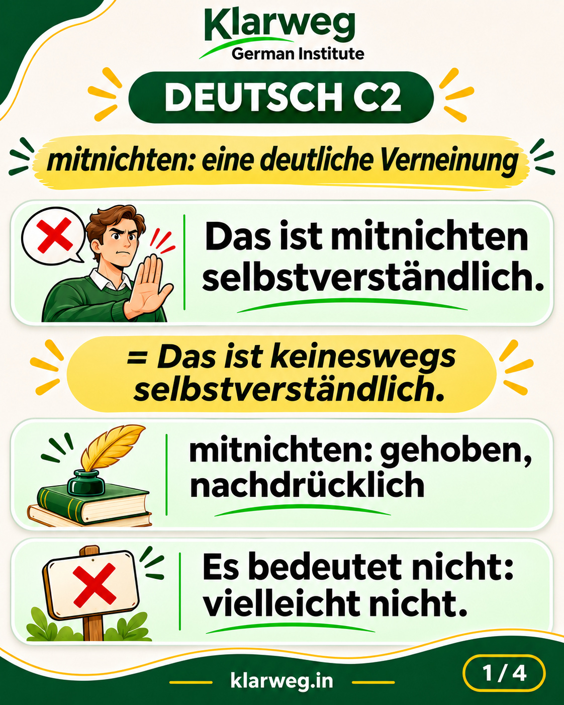

# Klarweg — six new content packages for 2026-11-21

**Prepared for review; not scheduled or published.**

Cream, forest green and gold themes. Each level has distinct Facebook and Threads captions plus a four-slide Instagram carousel. Every caption includes https://klarweg.in.

| Date | IST slot | Level | New topic | Download |
|---|---|---|---|---|
| 2026-11-21 | 00:00 | [A1](A1/) | können: ability | [All 3 platforms](downloads/Klarweg-A1-3-platforms.zip) |
| 2026-11-21 | 04:00 | [A2](A2/) | mit + Dativ | [All 3 platforms](downloads/Klarweg-A2-3-platforms.zip) |
| 2026-11-21 | 08:00 | [B1](B1/) | als oder wenn? Past events | [All 3 platforms](downloads/Klarweg-B1-3-platforms.zip) |
| 2026-11-21 | 12:00 | [B2](B2/) | einerseits … andererseits | [All 3 platforms](downloads/Klarweg-B2-3-platforms.zip) |
| 2026-11-21 | 16:00 | [C1](C1/) | zumal: einen weiteren Grund nennen | [All 3 platforms](downloads/Klarweg-C1-3-platforms.zip) |
| 2026-11-21 | 20:00 | [C2](C2/) | mitnichten: eine deutliche Verneinung | [All 3 platforms](downloads/Klarweg-C2-3-platforms.zip) |

[Download all six packages](downloads/Klarweg-all-6-slots.zip)

## Contents

Facebook and Threads use 01.jpg as a complete standalone lesson, with separate platform copy. Instagram uses 01.jpg through 04.jpg: hook/lesson, rule, examples, practice. JPEGs are ready for API publishing; original PNGs are included for reuse.

Times are the intended slots for this batch, not active schedules. The live publishing queue, ledger, account credentials and website deployments are unchanged. Instagram music is added manually in the app.

## Previews

### 00:00 IST — A1: können: ability

### 04:00 IST — A2: mit + Dativ

### 08:00 IST — B1: als oder wenn? Past events

### 12:00 IST — B2: einerseits … andererseits

### 16:00 IST — C1: zumal: einen weiteren Grund nennen

### 20:00 IST — C2: mitnichten: eine deutliche Verneinung

